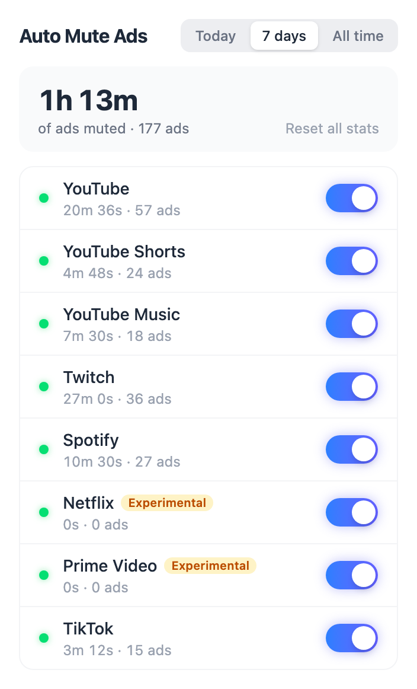

# Auto Mute Ads

**A Chrome extension that mutes the tab while an ad is playing, and unmutes it when the ad ends.**

Works on YouTube, YouTube Shorts, YouTube Music, Twitch, Spotify, TikTok, Netflix and Prime Video.

## Why mute instead of block?

Auto Mute Ads is not an ad blocker. Ads still load and play. You just don't have to listen to them. The one exception is YouTube, where a long ad is cut short by reloading the page (see the table below).

- **Nothing is blocked or modified.** No requests are filtered and no page content is removed.
- **One permission.** The extension only asks for `storage`. It does not request access to your browsing history or to network requests.
- **Nothing leaves your browser.** No data is collected and no external requests are made.

## How It Works

A content script watches each supported site for signs that an ad is playing. When an ad starts, the tab is muted. When the ad ends, the tab is unmuted. The mute is applied to the tab itself, so the site's own volume setting is left alone.

## Supported Services

| Service | Status | What happens during an ad |
|---------|--------|---------------------------|
| **YouTube** | Stable | The tab is muted. If the ad is still playing after 7 seconds, the page reloads and resumes from where you left off. |
| **YouTube Shorts** | Stable | The tab is muted until you swipe to the next Short. |
| **YouTube Music** | Stable | The tab is muted. Your queue is preserved. |
| **Twitch** | Stable | The tab is muted. |
| **Spotify** | Stable | The tab is muted. |
| **TikTok** | Stable | The tab is muted until you scroll to the next post. Paid partnership posts are not muted. |
| **Netflix** | Experimental | The tab is muted. Pause ads are ignored. |
| **Prime Video** | Experimental | The tab is muted. |

Each service can be turned on or off from the popup.

**Experimental** services are enabled by default, but their detection has not been verified on the real site by the maintainer yet, so it may not work reliably. They are labeled "Experimental" in the popup. Reports via [Issues](https://github.com/qkitzero/auto-mute-ads/issues) are welcome, whether it works for you or not.

How ads are detected on each service

| Service | Detection method |
|---------|------------------|
| **YouTube** | The `.ad-showing` class on the video player (`#movie_player`). The playback position is tracked so the page can resume after a reload. |
| **YouTube Shorts** | A Shorts ad (`ytd-ad-slot-renderer`) in the active reel, or `.ad-showing` on the Shorts player. |
| **YouTube Music** | The `.ad-showing` class on the shared YouTube player. |
| **Twitch** | Ad-related DOM elements (`video-ad-label`, `ad-countdown-container`, `.ad-showing`). |
| **Spotify** | Ad-related keywords in the document title (e.g. "Advertisement", "Audio Ad"). |
| **TikTok** | The ad label (`data-e2e="ad-tag"`, `data-e2e="ttam-ads-cta"`) on the post that is currently playing. |
| **Netflix** | The ad info overlay (`ads-info-container`, or an `ads-info-time` countdown) on the player. |
| **Prime Video** | A visible, non-empty ad timer (`atvwebplayersdk-ad-timer`, `atvwebplayersdk-adtimeindicator-text`) once the player is open. Falls back to overlay text such as "Ad 0:20". |

## Stats

The popup shows how much ad time has been muted — today, over the last 7 days, or all time — with a breakdown per service. Stats are stored locally and can be reset from the popup.

## Installation

1. Download the latest `auto-mute-ads-vX.X.X.zip` from the [Releases](https://github.com/qkitzero/auto-mute-ads/releases) page and extract it.
2. Open `chrome://extensions/` in Chrome.
3. Enable **Developer mode** (top right).
4. Click **Load unpacked** and select the extracted folder.

## Privacy

Auto Mute Ads requests only one permission:

- **storage** — to save your per-service toggle preferences and muted ad stats locally.

Muting, unmuting and reloading the tab where an ad is playing do not require any additional permission.

The extension:

- Stores only boolean on/off settings per service and the duration/count of muted ads per service and day in `chrome.storage.local`. Daily stats older than 90 days are removed automatically.
- Does **not** collect, transmit, or share any user data.
- Does **not** make any external network requests.
- Runs content scripts only on matching domains (`youtube.com`, `music.youtube.com`, `twitch.tv`, `open.spotify.com`, `netflix.com`, `tiktok.com`, `primevideo.com`, and the Amazon stores where Prime Video plays: `amazon.com`, `amazon.co.jp`, `amazon.co.uk`, `amazon.de`, `amazon.fr`, `amazon.it`, `amazon.es`, `amazon.ca`, `amazon.com.mx`, `amazon.com.br`, `amazon.in`, `amazon.com.au`). On Amazon store pages, the script does nothing unless the Prime Video player is open.

## Contributing

Bug reports and pull requests are welcome. See [CONTRIBUTING.md](CONTRIBUTING.md) for the development setup and conventions.

## License

[MIT](LICENSE)
